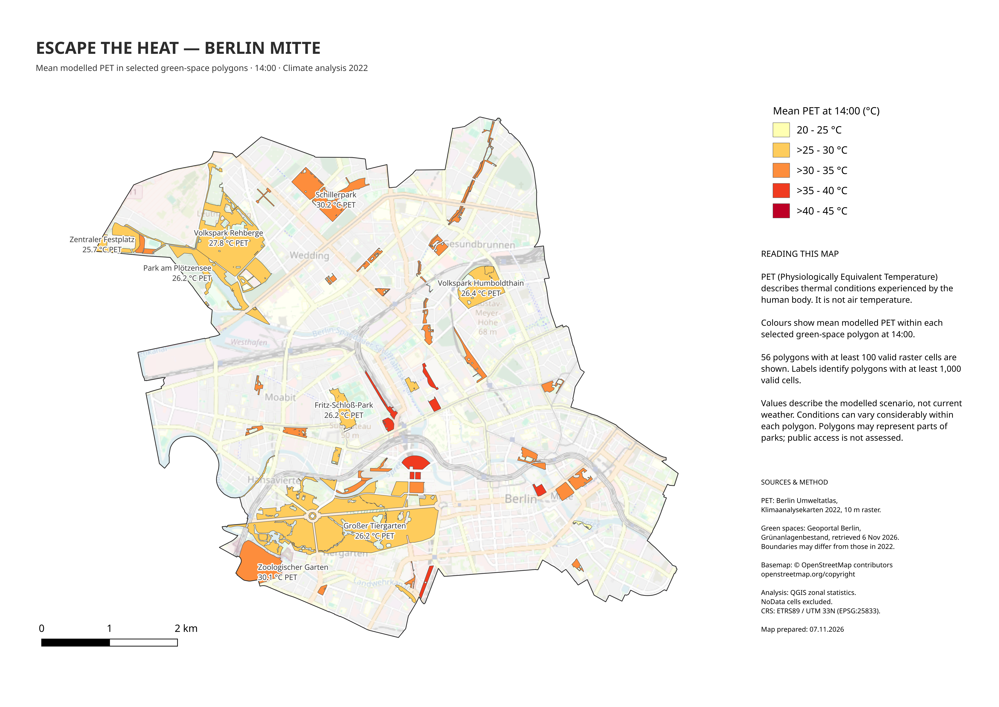

# Escape the Heat — Berlin Mitte

A QGIS project exploring modelled daytime heat stress in Berlin Mitte
and comparing mean Physiologically Equivalent Temperature (PET)
across selected green-space polygons.

The analysis uses the Berlin Environmental Atlas climate analysis 2022
PET raster for 14:00, with a spatial resolution of 10 × 10 metres.

## Map

[Download the map as a PDF](outputs/maps/mitte_green_spaces_mean_pet_2022.pdf)

## Project questions

- Where does modelled PET reach or exceed 35 °C within Mitte?
- How does mean PET vary between green-space polygons?
- Which selected green-space polygons have lower mean PET values
  in the modelled scenario?

## How to interpret the map

Colours represent mean modelled PET within each selected polygon.
PET describes thermal conditions experienced by the human body;
it is not air temperature.

The map shows 56 polygons with at least 100 valid raster cells.
Labels identify polygons with at least 1,000 valid cells.

Polygons may represent parts of parks. Public access is not assessed.
The results describe a modelled scenario, not current weather.

## Key results

Across the valid cells of the PET raster clipped to Mitte:

| Metric | Result |
| --- | ---: |
| Valid raster cells | 287,999 |
| Minimum PET | 18.38 °C |
| Maximum PET | 45.52 °C |
| Mean PET | 33.94 °C |
| Cells with PET ≥ 35 °C | 131,859 |
| Share of valid cells with PET ≥ 35 °C | 45.78% |
| Area represented by cells with PET ≥ 35 °C | 13.19 km² |

The percentage refers to valid raster cells, not the entire area
of Mitte. NoData cells are excluded.

For the green-space analysis, zonal statistics were calculated
for 277 polygons. Of these, 56 polygons with at least 100 valid
raster cells were retained for the final map.

Examples of mean PET for individual analysed polygons:

| Green-space polygon | Mean PET |
| --- | ---: |
| Großer Tiergarten — historic Tiergarten polygon | 26.17 °C |
| Volkspark Humboldthain — main polygon | 26.36 °C |
| Schillerpark — analysed polygon | 30.25 °C |

These values describe the analysed polygons and should not
automatically be interpreted as averages for entire parks.

## Workflow

1. Load the official PET raster and the Mitte district boundary.
2. Clip the raster to Mitte, preserving its 10 × 10 m resolution.
3. Treat source values of -99 as NoData and assign -9999
   as the output NoData value.
4. Calculate statistics from the valid cells of the clipped raster.
5. Create a binary raster identifying cells with PET ≥ 35 °C.
6. Load the official green-space polygons, select those assigned
   to Mitte, save them locally and clip them to the district boundary.
7. Calculate zonal statistics for each green-space polygon:
   valid cell count, mean, minimum and maximum PET.
8. Retain polygons with at least 100 valid raster cells
   for the final map.
9. Style polygons by mean PET and label those with at least
   1,000 valid cells.
10. Create an A3 landscape print layout and export PDF and PNG maps.

## Limitations

- The PET raster represents a modelled scenario at 14:00,
  not observed or current weather.
- The green-space dataset was retrieved in November 2026;
  its boundaries may differ from those relevant to the 2022 analysis.
- Individual polygons may represent only part of a park.
- A polygon mean can conceal substantial differences within
  the same green space.
- NoData cells are excluded; their absence does not indicate
  low heat stress.
- The 100-cell threshold is a practical map-selection criterion,
  not a validated statistical quality threshold.
- The 35 °C threshold is used for this project's comparison;
  the map's 5 °C colour intervals are not official PET stress classes.
- Public access, opening hours and entrance fees were not assessed.

## Data sources

### PET raster

Berlin Environmental Atlas — Climate Analysis 2022,
map 04.10.5: Physiologically Equivalent Temperature (PET) at 14:00.

Spatial resolution: 10 × 10 m.

- [Dataset description](https://www.berlin.de/umweltatlas/klima/klimaanalyse/2022/kartenbeschreibung/)
- [Official downloads](https://www.berlin.de/umweltatlas/klima/klimaanalyse/2022/download/)

The analysis uses the downloaded numerical raster.
The WMS service was used for visual inspection.

### Green spaces

Geoportal Berlin — Grünanlagenbestand Berlin
(einschließlich der öffentlichen Spielplätze).

The Grünanlagen layer was used; the separate playground layer
was not included. Data retrieved on 6 November 2026.

- WFS service: https://gdi.berlin.de/services/wfs/gruenanlagen

### District boundary

Source: Geoportal Berlin — Berlin district boundaries.

The boundary layer was originally downloaded for the
*Berlin Population Density 2025* project. For this analysis,
the Mitte feature was selected and exported to
`data/processed/mitte_boundary.gpkg`.

It was used to clip the PET raster and green-space polygons.

### Basemap

© OpenStreetMap contributors.

- [OpenStreetMap copyright and attribution](https://www.openstreetmap.org/copyright)

## Project structure

| Location | Contents |
| --- | --- |
| `data/raw/` | Original downloaded data; excluded from Git |
| `data/processed/` | Prepared boundaries, green-space polygons and PET rasters |
| `outputs/maps/` | Final map exports in PDF and PNG format |
| `outputs/` | Raster statistics reports |
| `project/` | QGIS project |
| `README.md` | Project documentation |

## Main files

| File | Purpose |
| --- | --- |
| `mitte_boundary.gpkg` | Mitte district boundary |
| `mitte_pet_2022.tif` | PET raster clipped to Mitte |
| `mitte_pet_ge35_2022.tif` | Binary raster: 1 for PET ≥ 35 °C, 0 below the threshold; NoData preserved |
| `mitte_green_spaces.gpkg` | Green-space features selected by district |
| `mitte_green_spaces_clipped.gpkg` | Green-space polygons clipped to Mitte |
| `mitte_green_spaces_pet_stats.gpkg` | Polygons with PET zonal statistics |
| `mitte_green_spaces_pet_min100.gpkg` | 56 polygons retained for the final map |

All files listed above are stored in `data/processed/`.

## Software and coordinate reference system

- QGIS for data preparation, raster calculations, zonal statistics
  and map layout.
- Analysis CRS: ETRS89 / UTM zone 33N — EPSG:25833.
- QGIS project: `project/escape_the_heat_berlin.qgz`.

